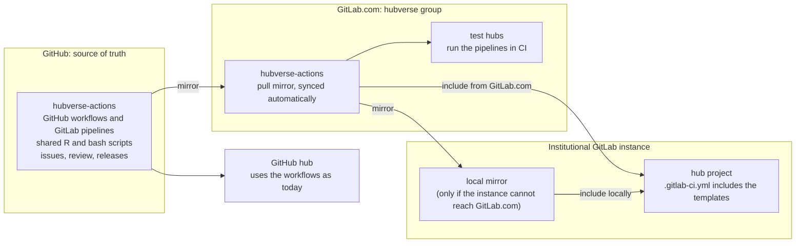

# Project Poster: Hubverse tooling on GitLab

- Date: 2026-10-12

- Owner: Anna Krystalli

- Team: Anna Krystalli, Ruarai Tobin (ACEFA), Matthew Cornell, Nicholas Reich

- Status: draft

## ❓ Problem space

### What are we doing?

Make the hubverse CI tooling usable by a hub hosted on GitLab, and establish whether the hubverse dashboard can be built and served from GitLab too. Today both depend strictly on github.com. The immediate driver is ACEFA, whose hub runs on a university GitLab instance and who have offered to do the porting work with us.

The work has three strands:

1. **A GitLab port of the hubverse CI workflows.** The validation workflows in [hubverse-actions](https://github.com/hubverse-org/hubverse-actions) (config, submission and target data validation, with the merge request comment that reports results) rewritten as GitLab CI pipelines, merged upstream and maintained as part of the hubverse.
2. **Hosting and distribution.** A place to keep, version and test the GitLab pipelines, and a way for a hub on a self-managed GitLab instance to install them.
3. **The dashboard on GitLab.** Whether the existing dashboard build tools can run as a GitLab pipeline and publish to GitLab Pages with access restricted to project members. The hubverse team scopes it in a project poster of its own before any commitment. ACEFA has no near-term need for it, so the scoping is not tied to their timeline.

### Why are we doing this?

**A hub needs it now.** ACEFA runs its hub on a university-hosted GitLab instance, where the hubverse workflows cannot be used because they have no GitLab version. ACEFA's offer to do the porting work is a good opportunity to do it together.

**Other hubs will face the same constraint.** Data sovereignty requirements are becoming more common for public health data. A hub subject to them cannot use github.com, and an institutional GitLab instance is the usual alternative. Setting a hub repository up on GitLab is simple enough, with automated tools for moving one, but without GitLab versions of the workflows the hubverse is not an option for such a hub.

**It removes a single-vendor dependency.** All hubverse CI runs on GitHub Actions and installs third-party actions from the GitHub marketplace. A second forge is a check that the tooling is not coupled to one provider, and GitLab is the forge preferred by a part of the open source community that should be able to use hubverse tools.

**Private dashboards.** The current dashboard publishes to GitHub Pages, which is public. GitLab Pages has access control built in, so a GitLab deployment is a direct route to a dashboard that only hub members can see.

### What are we _not_ trying to do?

- Not building a general multi-forge abstraction over the CI tooling. The port targets GitLab. GitHub Enterprise Server is out of scope. It runs GitHub Actions, so the existing workflows should largely work there, and any gaps are a separate, smaller piece of work.
- Not changing what the validation checks do. The R and bash logic in hubValidations and hubverse-actions stays as it is. The port covers the wrapper layer: pipeline YAML, the merge request comment, and the few places where our code calls the GitHub API or relies on GitHub runner conveniences.
- Not solving institutional access administration. Onboarding external collaborators onto an institutional GitLab instance, and granting them access to a restricted Pages site, is for the hosting institution to manage. It can be a significant administrative load, and a hub admin should plan for it.
- Not addressing cloud storage. Mirroring hub data to S3 for a hub with data residency requirements is a separate piece of work. A regional bucket in the hubverse account with cross-account roles, as suggested by AWS, is one candidate design, and a GitLab hub would need a non-GitHub route to assume the role in any case.
- Not porting the AWS upload workflow (`hubverse-aws-upload`) in the first phase. It depends on GitHub OIDC trust set up in hubverse-infrastructure, and the hubs asking for GitLab do not use it.

### How do we judge success?

- A hub on a self-managed GitLab instance can run config, submission and target data validation, with the same checks and the same results report on a merge request that a GitHub hub gets on a pull request.
- A hub admin can install and update the GitLab pipelines with an effort comparable to installing the GitHub workflows today, and without the hubverse team's involvement.
- ACEFA runs the ported pipelines on its hub.
- The port is not specific to ACEFA. A hub whose instance cannot reach the internet, and can only mirror, can install it by following the documented mirroring route.
- The port is maintained by the hubverse, versioned and released alongside the GitHub workflows, and is not a fork maintained by one hub.
- Changes to shared R code made for the port (hubValidations) are forge neutral and do not degrade the GitHub path.
- The dashboard strand ends in a project poster that either proposes a GitLab Pages deployment or records why not to pursue one.

### What are possible solutions?

#### CI port

GitLab has no marketplace of actions. A job is a script running in a container image, so each third-party action we use is either built in or becomes a few lines of shell. The pipelines themselves are templates with declared inputs, the closest GitLab analogue to our composite actions. A hub can pull them in two ways, by URL or from the instance's catalog, and both run on a prebuilt image. Inputs work with either, so the choice is only about how a hub fetches the template.

##### Templates pulled by URL or project

A hub's `.gitlab-ci.yml` pulls a template in by URL from any reachable host (`include: remote:`, which can point straight at the GitHub repository) or from another project on the same instance (`include: project:`). The hub's own file can be as short as:

```yaml
include:
  - remote: https://gitlab.com/hubverse/hubverse-actions/-/raw/v1.2.0/gitlab/validate-submission.yml
```

or, from a mirror at `gitlab.example.edu/hubverse/hubverse-actions` on the hub's own instance:

```yaml
include:
  - project: hubverse/hubverse-actions
    ref: v1.2.0
    file: gitlab/validate-submission.yml
```

##### Templates published as CI/CD components

The same template, published with a version to the instance's CI/CD catalog, where hubs can find it. The hub references it by name and version, with inputs validated against the template's declaration:

```yaml
include:
  - component: gitlab.example.edu/hubverse/hubverse-actions/validate-submission@1.2.0
    inputs:
      hub_path: .
```

##### Prebuilt container image

An image with hubValidations and its dependencies installed, used by the templates. It replaces the R setup and dependency caching actions, and the runner then needs to reach only a container registry. The GitHub workflows could run on the same image later.

##### Custom validation dependencies

A hub whose custom validations need extra packages names them in an `extra_packages` input in pak notation, as with the GitHub action, and the job installs them before validation runs. This needs the runner to reach a package repository. An `extra_repositories` input, as on the GitHub action, points pak at an internal CRAN mirror or Posit Package Manager instead of the public ones, or at r-universe for hubverse development versions. pak's `git::` notation fetches a package from the institution's own GitLab:

```yaml
include:
  - component: gitlab.example.edu/hubverse/hubverse-actions/validate-submission@1.2.0
    inputs:
      extra_repositories: ["https://ppm.example.edu/cran/latest", "https://hubverse-org.r-universe.dev"]
      extra_packages: ["any::mycustompkg", "git::https://gitlab.example.edu/acefa/validations.git"]
```

Note that a hub whose runners cannot reach a package repository can instead build its own image on top of ours (`FROM` our image, then `pak::pak()` the extra packages) and pass it as the image input.

#### Merge request file listing

`validate_pr()` and `validate_target_pr()` in hubValidations list changed files through the GitHub API. `git diff --name-status` against the target branch reports the same file name and status (added, modified, removed, renamed) on any forge, with no API or token. A GitLab merge request pipeline runs on the source branch and exposes the merge base SHA, so no fetch is needed when the clone reaches back that far. Both runners clone shallowly by default, so the wrapper may need to fetch the base commit first.

#### Dashboard

The three dashboard build tools (hub-dashboard-predtimechart, hubPredEvalsData via its Docker wrapper, hub-dash-site-builder) are container images or a pip package and run as GitLab jobs as they are. What does not transfer is the control room's orchestration, which is GitHub-specific throughout: a GitHub App token, discovery of dashboards through the app's installations, and pushes of the outputs to branches of each dashboard repository. On GitLab each hub runs its own pipeline that calls the tools and publishes to GitLab Pages with access control.

## ✅ Validation

### What do we already know?

Earlier scoping notes (2026-10-02) read the hubverse-actions, hubValidations and hubverse-infrastructure sources. The GitLab statements below were checked against GitLab documentation on 2026-10-12.

**How each GitHub Action we use maps to GitLab.**

| Action | GitLab equivalent |
|---|---|
| `actions/checkout` | Built in. The runner clones the repository before the job starts. |
| `r-lib/actions/setup-r` | Not needed. Set `image:` on the job to an R image or a hubverse image. |
| `r-lib/actions/setup-r-dependencies` | No direct equivalent. `pak::pak()` with a `cache:` entry, or packages baked into the image. |
| `actions/upload-artifact`, `actions/download-artifact` | Built in via `artifacts:`. |
| `actions/github-script` | None. Each use becomes a `curl` or `glab` call against the GitLab API. |
| `aws-actions/configure-aws-credentials` | `id_tokens:` plus `aws sts assume-role-with-web-identity`. Not needed in the first phase. |

**What is GitHub-specific in our own code.**

- hubValidations: `validate_pr()` and `validate_target_pr()` call the GitHub pull request files endpoint and use only the file name and status from the response. Everything downstream is forge neutral.
- hubverse-actions: `pr-comment` and `resolve-pr` are `actions/github-script` calls. `resolve-pr` is unnecessary on GitLab, because a merge request pipeline knows its merge request IID. The two-stage comment flow (`validate-submission-comment`) relies on the `workflow_run` trigger, which GitLab does not have.
- Runner conveniences: `GITHUB_STEP_SUMMARY`, `GITHUB_OUTPUT` and the `::error::` and `::notice::` workflow commands appear in the action YAML and in `validate.R`.
- hubCI installs workflows from hubverse-actions GitHub releases.
- The Dependabot template has Renovate as its GitLab counterpart.

The R and bash scripts are already separate from the action YAML, so the port is confined to the wrapper layer.

**GitLab behaviour that shapes the design.**

- A CI/CD component can only be referenced from the same GitLab instance. Using a GitLab.com component on a self-managed instance requires mirroring the component project there.
- The job token (`CI_JOB_TOKEN`) can read merge request notes but cannot create them. Posting the results comment needs a project access token stored as a CI/CD variable.
- A merge request pipeline from a fork runs in the fork by default, with the fork's variables. A parent project member can run it in the parent project instead, with the parent's variables, after accepting a warning.
- GitLab Pages access control is available on self-managed instances once an administrator enables it. A restricted site can be limited to project members, or to any user signed in to the instance. An external user can see it only with a project membership.

**ACEFA's instance** (answers from Ruarai Tobin on the first review).

- GitLab Community Edition 19.4.2, with Pages available.
- Runners have full internet access, so templates, packages and images need no mirroring in.
- Project access tokens can be created by the hub's own administrators.
- All submitters are members of the hub project.
- Dashboard JavaScript loaded from a CDN is acceptable. Only the data has to stay on their infrastructure.

### What do we need to answer?

Nothing outstanding. ACEFA's answers are recorded above.

## 👍 Ready to make it

### Proposed solution

Phased, with later phases started only as a hub needs them. ACEFA leads the pipeline work and the hubverse team reviews it. All changes to the R packages are made by the hubverse team.

**Phase 1: minimum GitLab port.**

1. The file listing in hubValidations taken from `git diff`, so `validate_pr()` and `validate_target_pr()` work on any forge (hubverse).
2. A prebuilt container image with hubValidations and its dependencies, built and published automatically on each hubValidations release (hubverse).
3. A GitLab version of the results comment, posting to merge request notes with a project access token (ACEFA).
4. Pipeline templates for config, submission and target data validation, running on that image, with the `extra_packages` and `extra_repositories` inputs for custom validation dependencies (ACEFA).

Config validation is the smallest piece and the natural starting point.

The pipelines assume submitters are members of the hub project, which is the normal case on an institutional instance. A merge request pipeline then runs in the hub project with its variables, and the results comment is posted in a single stage. A merge request from a fork runs in the fork without the project's token, so validation still runs and the pipeline status shows on the merge request, but no comment is posted. Supporting non-member submitters properly is left until a hub needs it.

**Phase 2: hosting and distribution** (hubverse).

5. A hubverse group on GitLab.com holding a mirror of the pipelines, the image and test hubs.
6. A documented installation route for self-managed instances, including mirroring. The include is three lines, so hubCI needs no GitLab support.

**Phase 3: dashboard** (hubverse, scoping first).

7. A project poster for the dashboard on GitLab, scoping what that would entail: how a hub's own pipeline is triggered and kept current without the control room, and how much of it the hubverse team will own given the existing maintenance load (see [2026-03-10 RFC](../../decisions/2026-03-10-RFC-dashboard-release-deployment.md)). That poster is where the decision on if and when to take it on is made.

#### Hosting and distribution

The GitLab pipelines are developed and released on GitHub, and GitLab.com carries a mirror. GitHub stays the single place for issues, review, versioning and releases, and keeping the GitLab pipelines next to the GitHub workflows they share scripts with avoids drift between them. GitLab CI can only run on GitLab, so a hubverse group on GitLab.com holds a pull mirror of the repository, which GitLab keeps in sync automatically, plus test hubs that exercise the pipelines. Releases and the container image are mirrored the same way. The mirror needs no upkeep once set up, and the group is needed in any case to test the pipelines. A hub whose instance can reach the internet includes the templates from the mirror or straight from the GitHub repository. An instance that cannot mirrors the repository once and its hubs include from that local copy. ACEFA does not need that route, but a hub that can only mirror is one the hubverse wants to support, and a mirror plus instructions for mirroring locally is a cheap way to do it.

How the pipelines get from GitHub to a hub:



#### Alternatives considered

**GitLab.com as the source of truth (rejected).** Develop and release the pipelines in a hubverse group on GitLab.com, where they run, and publish them as CI/CD components in the catalog. The team would then work across two forges, with the GitLab pipelines released out of step with the GitHub workflows they share scripts with. Institutional instances have to mirror a component project wherever it is published, so the catalog gains them nothing. Testing is the one thing GitLab.com has to provide, and a mirror provides it.

### Visualize the solution

Indicative layout of the port inside hubverse-actions (names illustrative):

```
hubverse-actions
  validate-config/
    action.yaml          GitHub wrapper
    validate.R           shared by both wrappers
  validate-submission/
  validate-target-data/
  pr-comment/            github-script
  gitlab/
    validate-config.yml  GitLab pipeline template
    validate-submission.yml
    validate-target-data.yml
    mr-comment.sh        GitLab API via curl
    image/Dockerfile     R + hubValidations

hubValidations
  validate_pr(), validate_target_pr()
    changed files <- git diff against the target branch
```

### Scale and scope

- **Team:** Ruarai Tobin (ACEFA), Anna Krystalli (owner), Matthew Cornell, Nicholas Reich. The split of work is given under Proposed solution.
- **Repos touched:** hubverse-actions, hubValidations; a hubverse group on GitLab.com; later the dashboard tool repositories if phase 3 proceeds.
- **Effort:** phase 1 is mostly translation of a small number of workflows and is expected to be modest. Phase 2 is small once phase 1 has settled the layout. Phase 3 is unknown until scoped.
- **Delivery date:** none set. Phase 1 is driven by ACEFA's need.
