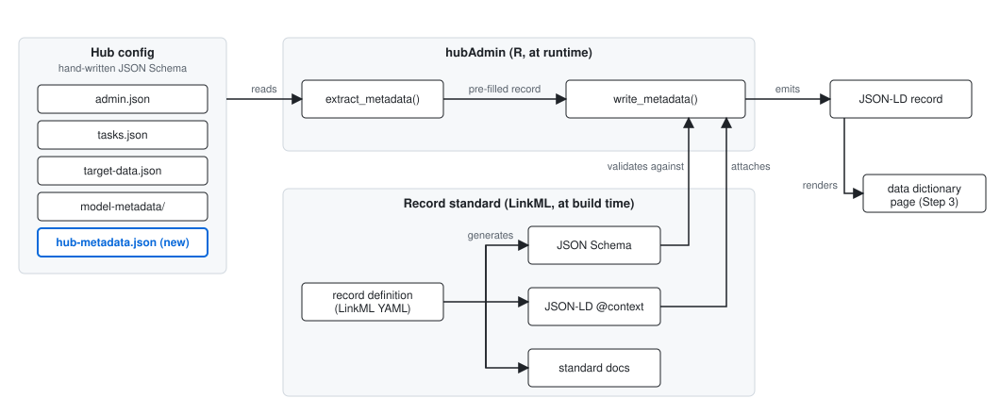
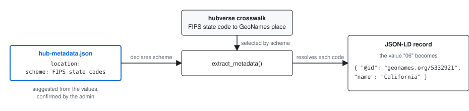

# Design: Metadata in the Hubverse

Companion to the [project poster](metadata-hubverse.md). The poster sets out the problem, the roadmap and the open questions. This document holds the design detail behind them: the new config file, the shape of the metadata record, the tooling, and how each phase is implemented.

Terms are used as the poster defines them in [Key terms](metadata-hubverse.md#key-terms). In particular, the **metadata record** is the JSON-LD our tooling generates for a hub, and `hub-metadata.json` is a config file the hub writes, one of the inputs to the record.

- [The metadata record and its data dictionary](#the-metadata-record-and-its-data-dictionary)
  - [Hubverse standard column definitions](#hubverse-standard-column-definitions)
- [The hub-metadata.json config file](#the-hub-metadatajson-config-file)
- [Tooling and where LinkML fits](#tooling-and-where-linkml-fits)
- [Phase 1 implementation](#phase-1-implementation)
- [Phase 2 mechanisms](#phase-2-mechanisms)

## The metadata record and its data dictionary

The record describes the hub as a schema.org [`DataCatalog`](https://schema.org/DataCatalog) and each data product (`model-output`, `time-series`, `oracle-output`) as a [`Dataset`](https://schema.org/Dataset). Each data product's data dictionary is its `variableMeasured` array, with each column a [`PropertyValue`](https://schema.org/PropertyValue). schema.org is the shared base. Where it lacks a field (for example a column's data type) we borrow one from another established standard, which is routine practice.

**Minimum per column:** `name`, `description`, `dataType`, `units` (numeric columns), and a `description` for each permissible value of categorical (string/factor) columns.

**Open: how to carry this in schema.org.** `PropertyValue` covers name, description and `unitText` but has no slot for `dataType` or per-value definitions, so those are borrowed from another standard (e.g. [CSVW](https://www.w3.org/TR/tabular-data-primer/)'s column `datatype`). Each target's units and statistical type from `target_metadata` describe what the `value` column holds in rows with that target, not the target value itself, so the record needs a slot on `value` that is conditional on `target`. `output_type_id` needs one conditional on target and output type. The dataset-level field set still needs pinning down. See the [schema.org datasets guide](https://schema.org/docs/data-and-datasets.html).

### Hubverse standard column definitions

The descriptions, types, and later terms and schemes, of the columns whose meaning the hubverse fixes:

- the standard task IDs in the tasks schema: `origin_date`, `forecast_date`, `scenario_id`, `location`, `target`, `target_date`, `target_end_date`, `horizon`, `age_group`
- the representation columns: `output_type`, `output_type_id`, `value`, `observation`, `oracle_value`, `as_of`, `model_id`
- the output types: `mean`, `median`, `quantile`, `cdf`, `pmf`, `sample`

They have to be written. The tasks schema's `description` of each standard task ID describes the config property ("An object containing arrays of required and optional unique origin dates") and only then the column, and the representation columns and output types are described in hubDocs prose only. We write them once from those sources and publish them as a versioned file in `hubverse-org/schemas`, so the R and Python tooling read the same definitions and they version with the standard task IDs they describe.

The poster's [Visualize the solution](metadata-hubverse.md#visualize-the-solution) shows a slice of a record. The `byTarget` structure on `value` there is a placeholder for the conditional slot.

## The hub-metadata.json config file

**Decision:** custom task ID metadata and output type category definitions are captured in the config up front, in a new optional file `hub-config/hub-metadata.json` with its own schema, `hub-metadata-schema.json`, in [`hubverse-org/schemas`](https://github.com/hubverse-org/schemas). The file is additive: nothing in `tasks.json` changes, and software that does not read the file behaves as it does today, so it stays within the poster's hard anti-aim.

The file holds two kinds of entry. `task_ids` is keyed by task ID name, standard or custom. Each entry can carry a description, a `type`, an identifier for the concept the column represents, and the code scheme its values use, plus a description and identifier per value where useful. `output_types` is keyed by output type and mirrors the `output_type` / `output_type_id` structure of `tasks.json`. Each entry can carry a description and an identifier for the output type, plus an `output_type_id` entry: what the ID holds for that output type, the code scheme its values use, and a description and identifier per value. Most of these meanings hold across the whole hub, so the file sits beside `tasks.json` rather than inside its per-round structure. It is not frozen: a definition that changes from one round on is added as a round entry, so earlier rounds keep their meaning.

`hub-metadata.json` is an input to extraction, not a schema.org record; the `Dataset` record is generated from it.

### Layered entries

Entries inherit through three levels, each overriding only what differs: the hubverse defaults (the hubverse standard column definitions), the hub (top level), and the round. `rounds` is an ordered list. An entry with `from` applies from that round ID until a later entry replaces it, so a weekly hub adds an entry only when a meaning changes. An entry with `round_ids` applies to those rounds only, for a one-off. Round IDs taken from a variable are dates and order by date; fixed round IDs follow their order in `tasks.json`. At the hub and round levels, `targets.<target_id>` overrides output type entries under one target (`large_increase` at different thresholds). Most hubs write only the hub level. Entries repeated across rounds can be written once under `$defs` and referenced with `$ref`. `hubAdmin` resolves both at extraction, so the record can be queried by round and modeling task, keyed as in hubUtils [#310](https://github.com/hubverse-org/hubUtils/issues/310), or directly by target.

> [!NOTE]
> Today a task ID's values can change type between rounds without anyone noticing: `tasks.json` is validated one round at a time, and `hubData::create_hub_schema()` silently widens the type. With `hub-metadata.json`, `validate_config()` checks each round's values against the `type` that applies to that round, and a mismatch is an error. The admin fixes it by correcting `type`, or by adding a round entry from the round where the type changed. The existing `validate-config` action runs these checks on every config pull request. The generated metadata file carries a version and modification date and is regenerated at each hub release, so a user can see what a column meant at any release.

### What the file is used for

- **`type` is authoritative.** Today `hubData::create_hub_schema()` infers a custom task ID's type from the R type of its configured values, which cannot tell, for example, a numeric code used as a label from an integer quantity. The `type` in the file is used instead of the inferred one, and validation checks submitted columns against it. Without the file, inference continues as today.
- **The Phase 2 value-linking hook is captured at source.** `term` and `scheme` are the slots the Phase 2 crosswalks fill, suggested by tooling and confirmed by the admin once, and the JSON-LD emission reads `term` as `propertyID`. They are recorded once in the config rather than reconstructed at every extraction.
- **Extraction reads instead of asking.** The Phase 1 Step 2 scaffold writes an entry for each custom task ID, and for each pmf or cdf output type with named categories, into this file. The admin completes it there, and extraction then needs no further input for those entries.

### Schema sketch

Follows the other config schemas: draft 2020-12, a required `schema_version`, `additionalProperties: false` throughout, and an `additional_metadata` escape hatch at the top level. Entries are defined under `$defs`: `task_ids` and `output_types` share the per-value entry, and a later section for non-task-ID columns can reuse the column entry. The `output_type_id` entry mirrors the column entry without `type`, which `tasks.json` already fixes. A round entry holds the same sections as the hub level, plus `from` or `round_ids`. References to the file's own `$defs` are accepted wherever an entry is expected; they are left out of the skeleton. jsonvalidate resolves the reference; the hubAdmin helpers for this file read the definition from `$defs` rather than by property path.

| Property | Required | Holds |
|----------|----------|-------|
| `schema_version` | yes | URL of the schema version the file is written for |
| `task_ids` | no | Object keyed by task ID name. Every key must name a task ID in `tasks.json` |
| `task_ids.<name>.description` | no | What the column is, for the data dictionary |
| `task_ids.<name>.type` | for a custom task ID's entry | One of `character`, `double`, `integer`, `logical`, `Date` (the `non_task_id_schema` enum). For a standard task ID, must be a type the tasks schema permits |
| `task_ids.<name>.term` | no | `{ uri, label }`: the ontology or vocabulary identifier for what the column is; emitted as `propertyID` |
| `task_ids.<name>.scheme` | no | `{ uri, label }`: the code list the values come from (FIPS state codes, ISO 3166), when there is one; selects the crosswalk |
| `task_ids.<name>.values` | no | Object keyed by value (written as a string). Each holds `description` and `term` for that value, where `term` identifies what the value denotes. Keys must be configured values of the task ID |
| `output_types` | no | Object keyed by output type. Every key must name an output type in `tasks.json` |
| `output_types.<name>.description` | no | What the output type is, for the data dictionary |
| `output_types.<name>.term` | no | `{ uri, label }`: the vocabulary identifier for the output type (for example a statistics ontology term for probability mass function) |
| `output_types.<name>.output_type_id.description` | no | What the ID holds for this output type (for `sample`, what one index represents) |
| `output_types.<name>.output_type_id.scheme` | no | `{ uri, label }`: the code list the values come from (MMWR epidemiological weeks), when there is one; selects the crosswalk |
| `output_types.<name>.output_type_id.values` | no | Object keyed by `output_type_id` value. Each holds `description` and `term` for that value. Keys must be configured `output_type_id` values of that output type |
| `targets` | no | Object keyed by target ID. Every key must name a `target_id` in `target_metadata`. Each holds `output_types` entries that apply under that target only |
| `rounds` | no | Ordered array of round entries. Each holds `task_ids`, `output_types` and `targets`, which override the hub-level entries, and exactly one of `from` or `round_ids` |
| `rounds[].from` | one of | Round ID from which the entry applies, until a later entry with `from` replaces it |
| `rounds[].round_ids` | one of | Array of round IDs the entry applies to, and no others |
| `$defs` | no | Named entries, referenced from any entry position with `{ "$ref": "#/$defs/<name>" }` |
| `additional_metadata` | no | Free-form, as in the other config files |

<details>
<summary>Schema skeleton (property descriptions omitted)</summary>

```json
{
  "$schema": "https://json-schema.org/draft/2020-12/schema",
  "$id": "https://raw.githubusercontent.com/hubverse-org/schemas/main/v7.0.0/hub-metadata-schema.json",
  "type": "object",
  "properties": {
    "schema_version": { "type": "string", "format": "uri" },
    "task_ids": { "$ref": "#/$defs/task_ids" },
    "output_types": { "$ref": "#/$defs/output_types" },
    "targets": { "$ref": "#/$defs/targets" },
    "rounds": {
      "type": "array",
      "items": { "$ref": "#/$defs/round" }
    },
    "$defs": { "type": "object" },
    "additional_metadata": { "type": "object", "additionalProperties": true }
  },
  "required": ["schema_version"],
  "additionalProperties": false,
  "$defs": {
    "round": {
      "type": "object",
      "properties": {
        "from": { "type": "string" },
        "round_ids": {
          "type": "array",
          "items": { "type": "string" },
          "minItems": 1
        },
        "task_ids": { "$ref": "#/$defs/task_ids" },
        "output_types": { "$ref": "#/$defs/output_types" },
        "targets": { "$ref": "#/$defs/targets" }
      },
      "oneOf": [{ "required": ["from"] }, { "required": ["round_ids"] }],
      "additionalProperties": false
    },
    "task_ids": {
      "type": "object",
      "additionalProperties": { "$ref": "#/$defs/column" }
    },
    "output_types": {
      "type": "object",
      "additionalProperties": { "$ref": "#/$defs/output_type" }
    },
    "targets": {
      "type": "object",
      "additionalProperties": {
        "type": "object",
        "properties": {
          "output_types": { "$ref": "#/$defs/output_types" }
        },
        "additionalProperties": false
      }
    },
    "column": {
      "type": "object",
      "properties": {
        "description": { "type": "string" },
        "type": { "enum": ["character", "double", "integer", "logical", "Date"] },
        "term": { "$ref": "#/$defs/term" },
        "scheme": { "$ref": "#/$defs/term" },
        "values": {
          "type": "object",
          "additionalProperties": { "$ref": "#/$defs/value" }
        }
      },
      "additionalProperties": false
    },
    "output_type": {
      "type": "object",
      "properties": {
        "description": { "type": "string" },
        "term": { "$ref": "#/$defs/term" },
        "output_type_id": { "$ref": "#/$defs/output_type_id" }
      },
      "additionalProperties": false
    },
    "output_type_id": {
      "type": "object",
      "properties": {
        "description": { "type": "string" },
        "scheme": { "$ref": "#/$defs/term" },
        "values": {
          "type": "object",
          "additionalProperties": { "$ref": "#/$defs/value" }
        }
      },
      "additionalProperties": false
    },
    "value": {
      "type": "object",
      "properties": {
        "description": { "type": "string" },
        "term": { "$ref": "#/$defs/term" }
      },
      "additionalProperties": false
    },
    "term": {
      "type": "object",
      "properties": {
        "uri": { "type": "string", "format": "uri" },
        "label": { "type": "string" }
      },
      "required": ["uri"],
      "additionalProperties": false
    }
  }
}
```

</details>

### Standard task IDs

The hubverse standard column definitions supply their description, plus `term` and `scheme` where the hubverse fixes them (ISO 8601 dates), and the tasks schema constrains their type, so an entry is optional. Inheriting these defaults nudges hubs toward shared identifiers. An entry may narrow the description to the hub's usage (for example `location` as two-digit FIPS codes), add `term` and `scheme`, and describe hub-specific values. Where the tasks schema permits more than one type (`horizon` and `scenario_id` may be integer or string), `type` settles which, as it does for a custom task ID. Values a hubverse crosswalk already covers need no per-value entries. The hub names the code list once in the column's `scheme` (FIPS state codes for `location`), and the crosswalk supplies each value's name and link at extraction. The scheme is suggested from the shape of the values and confirmed by the admin. Per-value entries are for values only the hub can explain. The `target` task ID keeps its value descriptions in `target_metadata`; `hub-metadata.json` adds only `term` for target values.

### Output types

The set of output types is fixed by the hubverse, so the hubverse standard column definitions supply a description of each, and from Phase 2 a `term`. What the record needs for `output_type_id` differs by output type:

| Output type | `output_type_id` holds | In the record | From the hub |
|-------------|------------------------|---------------|--------------|
| `mean`, `median` | `NA` | Marked as unused | Nothing |
| `quantile` | A probability level | One entry per configured level, generated (the 0.025 level is the 2.5% quantile), units from the target | Nothing |
| `cdf` | A value of the target: a numeric threshold, a date, or an ordinal category | One entry per configured value. Numeric and date values are generated from the target's scale. Ordinal categories take their order from `tasks.json`, which lists them from low to high | A description of each named category |
| `pmf` | A category of a discrete outcome, as a string, which may be a numeric value of the target | One entry per configured category. Numeric values are generated from the target's scale. Ordinal categories take their order from `tasks.json` | A description of each named category, or a `scheme` when the values are codes (the epiweek `EW202240`) |
| `sample` | A sample index | No per-value entries, since `tasks.json` does not list the indices. A description of what one index represents, generated from `compound_taskid_set` (one trajectory across horizons, for each location and reference date) and the sample counts | Optionally, a narrower description |

### Validation

JSON schema validation covers the structure. `hubAdmin::validate_config()` adds the checks that depend on `tasks.json`: every `task_ids` key names a configured task ID, every `values` key is a configured value of that task ID, every `output_types` key names a configured output type and every `output_type_id.values` key a configured value of it, `type` is present in a custom task ID's entry, and each round's values fit the `type` that applies to that round and, for a standard task ID, `type` is one the tasks schema permits. Keys under `targets` must name configured targets, every `from` and `round_ids` value must be a configured round ID, `from` values must be in round order, the keys within round and target entries are checked as at the hub level, and every `$ref` must resolve. A custom task ID with no entry, and a category shared by targets or changing between rounds without its own entry, are reported but do not fail validation.

### Example

A hub with one custom task ID, `pathogen`, a narrowed description of the standard `location`, and one pmf category whose threshold differs for one target. URIs are illustrative.

```json
{
  "schema_version": "https://raw.githubusercontent.com/hubverse-org/schemas/main/v7.0.0/hub-metadata-schema.json",
  "task_ids": {
    "pathogen": {
      "description": "Pathogen the target quantity refers to.",
      "type": "character",
      "values": {
        "flu": {
          "description": "Influenza",
          "term": { "uri": "http://purl.obolibrary.org/obo/NCBITaxon_11308", "label": "Influenza A virus" }
        },
        "covid": {
          "description": "COVID-19",
          "term": { "uri": "http://purl.obolibrary.org/obo/NCBITaxon_2697049", "label": "SARS-CoV-2" }
        }
      }
    },
    "location": {
      "description": "US states and territories as two-digit FIPS codes, plus \"US\" for the national level.",
      "scheme": { "uri": "https://www.census.gov/library/reference/code-lists/ansi.html", "label": "ANSI/FIPS state codes" }
    }
  },
  "output_types": {
    "pmf": {
      "output_type_id": {
        "values": {
          "large_increase": {
            "description": "The weekly rate rises by more than the hub's large-change threshold for the horizon."
          }
        }
      }
    }
  },
  "targets": {
    "wk flu hosp rate change": {
      "output_types": {
        "pmf": {
          "output_type_id": {
            "values": {
              "large_increase": {
                "description": "The weekly hospitalization rate rises by at least 2 per 100,000."
              }
            }
          }
        }
      }
    }
  }
}
```

## Tooling and where LinkML fits

The tooling has three parts. [LinkML](https://linkml.io/) is used in the middle one only, at build time, and never touches the hub config.

- **Inputs: the hub config.** `admin.json`, `tasks.json`, `target-data.json`, the model-metadata files and `hub-metadata.json`, validated by hand-written JSON Schema in `hubverse-org/schemas` as today. `hub-metadata.json` is one more input the extractor reads.
- **The record standard, authored in LinkML.** One YAML file, the **record definition**, states the record's classes and slots (hub as `DataCatalog`, data product as `Dataset`, column as `PropertyValue` with the borrowed `dataType` and per-value slots) and the standard term each slot maps to (`schema:description`, `csvw:datatype`, `dcterms:license`). Note that LinkML calls this file a schema; this document says record definition to keep it apart from the config schemas and from forecasting models. From that one file LinkML generates the JSON Schema that validates the record, the JSON-LD `@context` that links the record's keys to those terms, and the documentation of the standard. The generated files are committed and used as static files. Without LinkML, those three artifacts are hand-written and kept in sync by hand.
- **Extraction and emission, in `hubAdmin`.** `extract_metadata()` maps config into instances of the record. `write_metadata()` validates against the generated JSON Schema and attaches the generated context. R never depends on LinkML at runtime; generation runs in CI when the record definition changes.

The record definition is authored in Phase 1, since the record's structure and context are Phase 1 deliverables. Phase 2 adds slot-level mappings and `meaning` URIs on enum values to the same file, as hubs' `term` and `scheme` entries flow through. Phase 3 adds OWL and SHACL projections. `hub-metadata.json` and the record definition never reference each other: the hub records a column's `term`, the extractor places it in the record's `propertyID` slot, and the context types that slot as a URI.



A slice of the record definition, with the per-value and conditional slots left out until the open question on the minimum per column is settled. Each slot names the standard term it maps to; `gen-json-schema` turns this into the validator and `gen-jsonld-context` into the context that maps `name` to `schema:name`, `data_type` to `csvw:datatype` and so on.

```yaml
id: https://hubverse.io/metadata-record
name: hubverse-metadata-record
prefixes:
  linkml: https://w3id.org/linkml/
  hub: https://hubverse.io/metadata-record/
  schema: http://schema.org/
  csvw: http://www.w3.org/ns/csvw#
default_prefix: hub
default_range: string
imports:
  - linkml:types

classes:
  Dataset:
    class_uri: schema:Dataset
    slots: [name, description, license, variables]
  Variable:
    class_uri: schema:PropertyValue
    slots: [name, description, data_type, unit, term]

slots:
  name:
    slot_uri: schema:name
    required: true
  description:
    slot_uri: schema:description
  license:
    slot_uri: schema:license
  variables:
    slot_uri: schema:variableMeasured
    range: Variable
    multivalued: true
  data_type:
    slot_uri: csvw:datatype
    range: DataType
  unit:
    slot_uri: schema:unitText
  term:
    slot_uri: schema:propertyID
    range: uriorcurie

enums:
  DataType:
    permissible_values:
      character:
      double:
      integer:
      logical:
      Date:
```

The `@context` is a lookup table that ships with the record and gives each key its meaning as a URI, so a reader sees `name` as `schema:name` and `data_type` as `csvw:datatype` rather than as labels we chose. LinkML generates it from the terms declared in the record definition.

## Phase 1 implementation

Phase 1 is delivered in `hubAdmin`, with the config schema in `hubverse-org/schemas`.

**Step 1: dataset-level record.**

- `extract_metadata(hub_path)` reads `admin.json` (name, maintainer, contact, repository URL, citation, file formats) and the list of data products a hub publishes, and returns a pre-filled record, stamped with a version and modification date: the hub as a `DataCatalog`, each data product as a `Dataset` inheriting the hub-level fields.
- The gaps extraction cannot fill are exactly three: a free-text description, the license and keywords. The record carries them as empty fields rather than leaving them out, so the admin sees exactly what to fill in, and `write_metadata()` reports any still empty.
- `write_metadata()` emits the record as JSON-LD, validated against the JSON Schema and carrying the `@context` generated from the record definition; values stay literals.

**Step 2: per-column data dictionary.** Adds `variableMeasured` to each data product's `Dataset` from Step 1.

- the `hub-metadata-schema.json` release in `hubverse-org/schemas` comes first, with its `hubAdmin::validate_config()` checks and `hubData::create_hub_schema()` reading `type` from `hub-metadata.json`
- pull every column name from `tasks.json` and `target-data.json`, with authoritative types for standard task IDs, the representation columns, non-task-id target columns typed in `target-data.json`, and custom task IDs typed in `hub-metadata.json`
- auto-describe standard task ID columns and the representation columns (`output_type`, `output_type_id`, `value`, `observation`, `oracle_value`) from the hubverse standard column definitions
- pull `target` column descriptions from `target_metadata`
- derive the `output_type_id` entries from `tasks.json`: which values occur under each target and output type, in which rounds, and the order of ordinal categories; generated descriptions of quantile levels and of numeric or date cdf and pmf values; and the structure of samples from `compound_taskid_set` and the sample counts. The record's `output_type_id` entry is conditional on target and output type, as `value` is on target. `hub-metadata.json` supplies only category descriptions, schemes and terms
- scaffold a `hub-metadata.json` entry for each custom task ID column, with `type` pre-filled from today's inference for the admin to confirm and `description` left empty to write, and the same for hub-specific value sets and named pmf and cdf categories, as target or round entries where they vary
- alternatives to editing JSON: a form (see the [low-code poster](https://github.com/reichlab/decisions/pull/41)) and an LLM skill that drafts descriptions from a hub's README for the admin to review

**Step 3: human-readable output.** A data dictionary and landing page generated from the Step 2 JSON-LD (as `dataspice` builds a site from its JSON-LD), with the JSON-LD embedded in the page.

## Phase 2 mechanisms

**Crosswalks.** A column's `scheme` in `hub-metadata.json` names the code list its values come from. Where we ship a crosswalk for that code list, extraction uses it to turn each code into a linked entity in the record:



We ship and maintain the crosswalks for standard columns and values (FIPS↔GeoNames for `location`, EDAM for file formats, OWL-time for timezones, a target→concept map, output types→statistics vocabulary terms). Admins only confirm the suggested scheme and map genuinely hub-specific values. Hubs can still add or override with their own, and confirmed mappings for hub-specific values are written to `hub-metadata.json` so every extraction reuses them.

**Dataset-level enrichment.** Suggest the `model-output` license from the per-model licenses in model-metadata (e.g. the most restrictive, flagging incompatible combinations) for admin confirmation, with `target-data` licensing recorded separately from its upstream source. Derive temporal coverage from the date columns and `time_unit`, and the geographic extent from the location codes through the crosswalk. Render model cards from each hub's own model-metadata schema.

**Provenance** with [PROV-O](https://www.w3.org/TR/prov-o/). For target data, the target-data maintainer declares the upstream source once and tooling records it and the `as_of` versions. For model output, lineage to a model's `data_inputs` (the upstream data the modeler used) is the modeler's responsibility and lives in their model-metadata. We cannot derive it for them, but we can provide the modeler-facing analog of the admin crosswalks: documentation plus an interactive lookup of common data sources and their identifiers, so modelers select structured references rather than writing free text.

**Row-level metadata in collected data.** `collect_hub()` stamps collected model output with the resolved metadata of each row's round, modeling task and target, through the read-time stamping proposed in the [`model_out_tbl` subclasses poster](https://github.com/reichlab/decisions/pull/39). hubData adds a `round_id` column at read time from the file name, so rounds whose ID is not taken from a variable can be stamped too.
