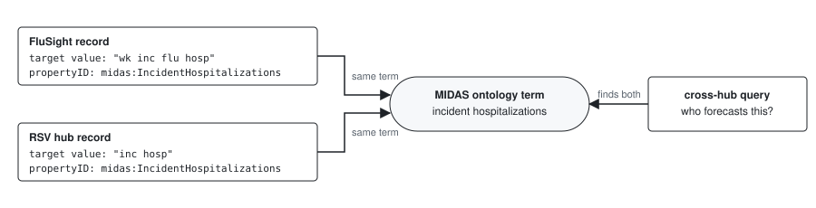

# Project Poster: Metadata in the Hubverse

- Date: 2026-06-26

- Owner: Harry Hochheiser and Anna Krystalli (drivers)

- Team: TBD

- Stakeholder: Nicholas Reich

- Status: draft

Design detail (the new config file, the record structure, the tooling and the implementation of each phase) is in the companion [design document](design.md).

## ❓ Problem space

### What are we doing?

Building tooling that captures, stores and progressively enriches descriptive metadata for the data products a hub publishes. The aim is that anyone who accesses hub data understands every column they encounter, and that a hub's claim to follow the FAIR principles rests on machine-readable metadata rather than convention.

The approach follows [`dataspice`](https://github.com/ropensci/dataspice):

1. **Extract what already exists.** Column names and types, and the definitions of standard columns, are derivable from the hub config and hubverse conventions.
2. **Make completing the rest easy.** Admins are asked only for what cannot be inferred: descriptions of custom columns and a few dataset-level fields.
3. **Start minimal and build up in phases.** Phase 1 settles the structure so later phases extend it rather than rewrite it.

### What a data user actually encounters

A user accessing hub data downloads tabular data products whose columns are **mostly task ID columns** plus a small number of fixed columns:

| Data product | Columns |
|--------------|---------|
| `model-output` | several **task ID** columns (e.g. `target`, `location`, `horizon`, `reference_date`, `scenario_id`, `age_group`) + `output_type` + `output_type_id` + `value` (+ `model_id` when collected) |
| `time-series` target data | task ID columns (including a date) + `observation` (+ optional `as_of`, + non-task-id columns like `location_name`) |
| `oracle-output` target data | a subset of task ID columns (+ `output_type`/`output_type_id` for pmf/cdf) + `oracle_value` (+ optional `as_of`) |

What makes these reusable is a **data dictionary**: what each column is, its type, units and permissible values. For a forecast hub's `model-output`, part of it could look like this (illustrative):

| Column | Description | Type | Units or values | Comes from |
|--------|-------------|------|-----------------|------------|
| `reference_date` | Saturday of the week the forecast is made | Date | ISO 8601 date | hub admin (custom task ID) |
| `location` | US state or territory, or the nation | character | `06`: California, `US`: United States | standard definition, narrowed by the hub |
| `horizon` | Weeks ahead of `reference_date` | integer | weeks | standard definition |
| `target` | Quantity being forecast | character | `wk inc flu hosp`: weekly incident influenza hospitalizations | `tasks.json` |
| `output_type_id` | Quantile level, or pmf category | character | `0.025`: the 2.5% quantile; `large_increase`: the rate rises by more than the hub's threshold | generated, and hub admin for named categories |
| `value` | The predicted value | double | a count for `wk inc flu hosp` | standard definition, units from `tasks.json` |

Most of each row can be filled automatically. The admin is asked only for what the config cannot say.

### Why are we doing this?

- **Data integrity and reuse by a wide audience.** A hub is configured by a few admins but serves many more people: modeling teams, public health decision-makers, researchers and downstream analysts, most of whom were not involved in its setup and may arrive long after it. Each of them needs to understand, from the metadata alone, what each column means, what the observed quantity is, and how it was generated.
- **Honest FAIR claims.** Today a hub's FAIR story is: data are openly available from a GitHub repo (for some hubs also an S3 mirror) in a standardized hubverse format, with config files describing the modeling tasks. That is a real baseline for Findable and Accessible. Beyond it there is no assembled, machine-readable description of a hub's data, no data dictionary surfaced to users, and no persistent identifiers.
- **Closing concrete usability gaps.** Harry's analysis names three: the language describing **models**, the language describing **targets** (and, more broadly, the columns), and the **permanence of results** (stable identifiers for a hub's data).
- **Actively requested by hub admins and the community.** In [hubverse discussion #40](https://github.com/orgs/hubverse-org/discussions/40) several maintainers (Harry, Anna, Sam Abbott, Kath Sherratt, CyGei and others) ask for exactly this: machine-readable (JSON-LD) hub metadata, structured metadata and best-practice reporting standards, standardized target naming and ontologies so targets are comparable across hubs, and per-model **model cards** (HuggingFace-style) describing how each model works.
- **Metadata at the point of access.** Descriptions, units and provenance are most valuable where people meet the data, not buried in a file. As with a web service where metadata is reviewed before data is pulled, anyone coming to a hub should be able to review the data dictionary and dataset description first.
- **Harmonisation across hubs, and meta-analysis.** Values linked to shared URIs make data from different hubs comparable and poolable. Their quality also depends on tying each model output row to the precise metadata of its round, modeling task and target.



### What are we _not_ trying to do?

- Not leading with ontologies or formal standards. The MVP is the pragmatic foundation; vocabularies and ontology mapping come later (see roadmap).
- Not requiring hubs to re-enter information that already exists in their config files or that the hubverse already defines for standard columns.
- **(Hard anti-aim) No schema change that requires downstream software adaptation.** The hub config [`schemas`](https://github.com/hubverse-org/schemas) are depended on by the whole software stack, so we will not change the meaning or structure of existing config properties (for example, what a task ID property holds). Purely *additive*, backward-compatible config metadata that downstream software can safely ignore is acceptable, and in some cases desirable (the new [`hub-metadata.json`](#key-terms)).
- Not building a hosted metadata portal or catalogue in Phase 1.

### How do we judge success?

- Before or when accessing any hub data product (through `hubData`/the Python client or a viewer), a user can review a clear data dictionary for every column, plus a dataset-level description of what the data is, who maintains it, how to cite it, and its license.
- The large majority of that metadata is generated from config and hubverse conventions; admins supply only descriptions of custom columns and a few dataset-level fields, with low friction.
- Metadata is published as machine-readable JSON-LD using the schema.org/Dataset vocabulary, plus a generated human-readable page.
- Phase 1 field naming and structure follow a recognized standard, so adding links to vocabularies and identifiers later is an extension, not a rewrite.

### What are possible solutions?

The proposed approach is the three-phase roadmap in [Ready to make it](#-ready-to-make-it). Each phase is independently useful and releasable.

## ✅ Validation

### What do we already know?

Much of the metadata is already present or derivable; the work is to assemble, complete and surface it.

| Metadata a user needs | Available now? | Source |
|-----------------------|----------------|--------|
| Column **names** for all data products | Yes | `tasks.json`, `target-data.json` |
| Column **data types** | Yes for standard columns and target data columns. Custom task ID types are only inferred from their values today | tasks schema, `target-data.json` |
| Descriptions of **standard task ID columns** (e.g. `origin_date`, `horizon`, `location`) | Partly: the tasks schema describes each as a config property, not as a column | tasks schema, hubDocs |
| Descriptions of the **representation columns** (`output_type`, `output_type_id`, `value`, `observation`, `oracle_value`) | Fixed hubverse meaning, described in prose only | hubDocs |
| **Target** column values | Yes, partially | `tasks.json` `target_metadata` |
| Descriptions of **custom columns** and their values | No | proposed: `hub-metadata.json` |
| Definitions of **named output type categories** (e.g. the pmf category `large_increase`) | No, only in READMEs and websites | proposed: `hub-metadata.json` |
| **Dataset-level** identity: name, maintainer, contact, citation, repository, file formats | Yes | `admin.json` |
| **Dataset-level** description | No | admin |
| **Data license** | Partly: per-model licenses exist, no hub-level license | model-metadata; admin |
| **Temporal coverage** | Derivable | date columns, `time_unit` |
| **Spatial coverage** | Partly: the location codes are known, but not the places they name | location codes; Phase 2 crosswalks |
| **Model** descriptions | Yes, in mature hubs | per-model `model-metadata` |

- **Standard column definitions are the key win.** The hubverse already fixes the meaning of the standard task ID columns, the representation columns and the output types. Written once as the hubverse standard column definitions, they describe most columns of most data products. Custom task IDs and named output type categories are the gap, and `hub-metadata.json` fills it.
- **Model metadata varies between hubs.** We provide a template model-metadata schema, but each hub sets its own (see [FluSight model-metadata](https://github.com/cdcepi/FluSight-forecast-hub/tree/main/model-metadata)). The tooling must read each hub's own schema. FluSight's schema already has an optional ORCID field and a `license` enum, so such conventions are MVP-level adoptions.
- **`dataspice` is a proven model** for the extract-then-scaffold workflow and for the staged progression from a simple standard to a richer one.
- **Harry's sketch maps the destination**: a FAIR metadata standard in JSON-schema and JSON-LD, with schema.org and Dublin Core as the spine and domain ontologies for specific fields (the Phase 3 list). [`LinkML`](https://linkml.io/), which he suggests as an authoring layer, is adopted for the record standard (see the [design document](design.md#tooling-and-where-linkml-fits)). Source: [Opportunities/challenges for Hubverse metadata](https://docs.google.com/document/d/1ewJ8JFBtuUb62Qchd_tO0rWQSYUseP7U4j80O9sKUjA/edit).

### What do we need to answer?

- **The unit of a record and of a persistent identifier** (Harry's third gap, Nick's key question). Reuse needs units finer than the hub: a round for scenario hubs, perhaps a monthly window for forecast hubs. Each unit would get its own persistent identifier, so it can be cited on its own. The minting mechanism (e.g. DataCite/Zenodo DOIs) is a separate choice. Likely Phase 2, but the MVP must not preclude it.
- **How complete are the hubverse standard column definitions**, and how do we detect when a hub's column is standard rather than custom (exact name match, or something more flexible)?
- **Which of Harry's field-to-standard mappings are cheap enough for Phase 1?** Some need no ontology machinery, just a convention on an existing field (ORCID, DOI, ISO 8601 dates). Heavier mappings (MIDAS ontology for targets, EDAM for formats, GeoNames for locations) are Phase 2+.
- **Which fields form the recommended core of model metadata**, checked by the validation tools, given that each hub sets its own model-metadata schema.
- **How the data dictionary is carried in schema.org**, which lacks slots for a column's data type and for per-value definitions (see the [design document](design.md#the-metadata-record-and-its-data-dictionary)).
- **Where the metadata record lives in a hub.** Candidate: a top-level `metadata/` directory holding the JSON-LD and the generated page. The cloud sync would need to mirror it.

## 👍 Ready to make it

### Proposed solution

Tooling in `hubAdmin` that generates a **metadata record** for every hub, mostly from the config the hub already has, with one new optional config file for what the config cannot say. A three-phase roadmap builds the record up: Phase 1 describes everything in plain text, Phase 2 links values to shared identifiers, Phase 3 connects to domain ontologies.

Three design principles run throughout:

> **Any metadata is better than none.** Start small, cover the bare minimum, then build up. Every phase leaves a hub more discoverable and better described than before.

> **Decide early for later.** Phase 1 settles a schema.org-based structure and naming, borrowing fields from Dublin Core, CSVW and others where needed, so later work extends rather than rewrites.

> **We build the tooling, not a mandate.** For every step we provide automation, shared crosswalks or suggestions to confirm, so the effort on hub admins and modelers stays minimal. Where manual input is unavoidable, we say whose responsibility it is: admin, modeler, or us.

#### Key terms

- **Metadata record**: the machine-readable description of a hub and its data products that our tooling generates, as JSON-LD using schema.org. Catalogues, search engines and the access tools read it.
- **Data dictionary**: the part of the record that describes each column of a data product.
- **Hubverse standard column definitions**: descriptions, types, and later terms and schemes, of the standard task ID columns, the representation columns and the output types. We write them once, drawing on the tasks schema and hubDocs, and publish them as a versioned file in `hubverse-org/schemas`. Every hub inherits them.
- **`hub-metadata.json`**: a new optional config file, `hub-config/hub-metadata.json`, where a hub describes what the rest of its config cannot: custom task IDs, named output type categories, and meanings that change between rounds or targets. Tooling drafts it; the admin completes it. It is an input to the record, and nothing in `tasks.json` changes ([design](design.md#the-hub-metadatajson-config-file)).
- **Term**: a URI that says what a column or value means, from a shared vocabulary or ontology.
- **Scheme**: the code list a column's values come from, such as FIPS state codes.
- **Crosswalk**: a mapping we maintain from a scheme's codes to linked entities, such as FIPS codes to GeoNames places.

Where each part of the Phase 1 record comes from:


| Phase | Adds | Deliverable |
|-------|------|-------------|
| 1. Minimum viable metadata | A record and data dictionary for every hub, values as plain text | JSON-LD record, human-readable page, `hub-metadata.json` |
| 2. Mature and enrich | Values linked to shared identifiers; persistent identifiers; metadata in the access tools | Linked record, DOIs, FAIR report |
| 3. Domain ontologies and ecosystem | Domain ontology terms; cross-hub discovery | Ontology crosswalks, cross-hub search |

### Visualize the solution

A slice of a `model-output` record. Illustrative and simplified; URIs are examples.

**Phase 1:** the keys follow schema.org, and the values are plain text. Each column is described once, and each of its values beneath it.

```json
{
  "@context": "https://schema.org",
  "@type": "Dataset",
  "name": "FluSight model output",
  "license": "CC-BY-4.0",
  "creator": { "@type": "Person", "name": "Jane Modeler" },
  "variableMeasured": [
    { "@type": "PropertyValue", "name": "location",
      "description": "US state, as a two-digit FIPS code",
      "values": [
        { "name": "06", "description": "California" },
        { "name": "US", "description": "United States" }
      ] },
    { "@type": "PropertyValue", "name": "target",
      "description": "Quantity the row's value refers to",
      "values": [
        { "name": "wk inc flu hosp",
          "description": "Weekly incident influenza hospitalizations" },
        { "name": "wk inc flu prop ed visits",
          "description": "Weekly proportion of emergency department visits due to influenza" }
      ] },
    { "@type": "PropertyValue", "name": "horizon",
      "description": "Weeks ahead of the reference date",
      "unitText": "week" },
    { "@type": "PropertyValue", "name": "value",
      "description": "Predicted value; units and type depend on target",
      "byTarget": [
        { "target": "wk inc flu hosp", "unitText": "count" },
        { "target": "wk inc flu prop ed visits", "unitText": "proportion" }
      ] }
  ]
}
```

**Phase 2:** the values become links (red removed, green added).

```diff
   "@type": "Dataset",
   "name": "FluSight model output",
-  "license": "CC-BY-4.0",
+  "license": { "@id": "https://creativecommons.org/licenses/by/4.0/" },
-  "creator": { "@type": "Person", "name": "Jane Modeler" },
+  "creator": { "@type": "Person", "name": "Jane Modeler",
+               "@id": "https://orcid.org/0000-0002-1825-0097" },
   "variableMeasured": [
     { "@type": "PropertyValue", "name": "location",
       "description": "US state, as a two-digit FIPS code",
       "values": [
-        { "name": "06", "description": "California" },
+        { "name": "06", "description": "California",
+          "@id": "https://www.geonames.org/5332921" },
         ...
       ] },
     { "@type": "PropertyValue", "name": "target",
       "description": "Quantity the row's value refers to",
       "values": [
         { "name": "wk inc flu hosp",
-          "description": "Weekly incident influenza hospitalizations" },
+          "description": "Weekly incident influenza hospitalizations",
+          "propertyID": "midas:IncidentHospitalizations" },
         ...
       ] },
     ...
   ]
 }
```

---

### Phase 1: minimum viable metadata (MVP)

*Goal: every hub ships a metadata record with a data dictionary for each data product, mostly generated, with the rest easy to complete.* Four stacked steps, each releasable on its own ([implementation](design.md#phase-1-implementation)).

**Step 1: dataset-level record.** Name, maintainer, contact, citation and the data products are read from `admin.json`. The admin adds a description, license and keywords, which the record shows as empty fields until filled.

- *Done when:* two function calls on any existing hub yield a record that passes the [schema.org validator](https://validator.schema.org/), and the admin has typed only the description, license and keywords.

**Step 2: data dictionary.** Every column is named and typed from the config. Standard columns are described by the hubverse standard column definitions, and `target` values by `target_metadata`. Tooling drafts `hub-metadata.json` entries for custom task IDs and named output type categories, and the admin completes them, by editing the file, through a form, or with an LLM skill that drafts descriptions to review. This step releases `hub-metadata-schema.json` and its validation.

- *Done when:* a hub whose columns are all standard gets a complete dictionary with no admin input, and a hub with a custom task ID (FluSight's `reference_date`) is asked only to complete the drafted entries.

**Step 3: human-readable page.** A data dictionary and landing page generated from the record and served from the hub repo. The embedded JSON-LD also makes the data products findable through Google Dataset Search.

- *Done when:* a hub's repo serves the page, and it passes Google's [Rich Results Test](https://search.google.com/test/rich-results) for `Dataset`.

**Step 4: cheap conventions.** Identifier conventions that need no ontology machinery and are already precedented: ORCID and the `license` enum, with DOI for citations and ISO 8601 dates as candidates.

---

### Phase 2: mature and enrich

*Goal: link values to shared identifiers and add persistent identifiers, with tooling doing the heavy lifting so the burden on hubs stays low.* ([mechanisms](design.md#phase-2-mechanisms))

- **Link values to shared identifiers.** Location codes, targets, contributors and licenses become links rather than plain text. We ship the common crosswalks (FIPS to GeoNames, a target to concept map, output types to statistics terms), selected by each column's scheme. Admins only confirm suggestions and map values specific to their hub.
- **Enrich the dataset-level record:** a suggested license from the per-model licenses, temporal and geographic coverage, and **model cards** rendered from model-metadata.
- **Persistent identifiers:** a workflow that mints DOIs from the hub, so the hub owner opts in rather than minting by hand.
- **Provenance:** the upstream source of target data, recorded once. Modelers get documentation and a lookup of common data sources for their models' `data_inputs`.
- **Row-level metadata in collected data.** Collected model output carries the metadata of each row's round, modeling task and target, building on the stamping in the [`model_out_tbl` subclasses poster](https://github.com/reichlab/decisions/pull/39).
- **FAIR self-assessment:** a report of what each hub has against the standard, with a maturity score, alongside external assessment with [F-UJI](https://www.f-uji.net/).
- **Metadata where people access data:** in `hubData` and the Python client, on the dashboards, and optionally in the viewers or as reusable web widgets in a recognisably hubverse style.

**Deliverable:** a linked metadata record, persistent identifiers, a FAIR maturity report, and metadata surfaced in the access tools.

---

### Phase 3: domain ontologies and ecosystem

*Goal: formal interoperability within and across hubs, and integration with the wider data ecosystem.*

- **Domain ontology mapping**: MIDAS ontology for targets, NCBI taxon for pathogens/vectors, SNOMED/ICD10 for outcomes, Software License Ontology for licenses, NIH RePORTER for funding.
- **Publish the hubverse's column and target definitions as an ontology**, so other ontologies and tools can reference them.
- **Link model metadata to model abstracts** and tackle the hardest case, ontologizing methods (where MIDAS work is ongoing).
- **Cross-hub catalogue, search and comparison**; certifiable FAIR scoring; integration with external repositories and portals.

**Deliverable:** domain-ontology crosswalks, the hubverse definitions published as an ontology, and cross-hub discovery and comparison.

---

### Relationship to existing work

This project adds a descriptive-metadata layer on top of the existing config schemas and data-product conventions. It adds one optional config file, `hub-config/hub-metadata.json`, and changes none of the existing schemas (see the hard anti-aim). It operationalizes Harry's [FAIR metadata sketch](https://docs.google.com/document/d/1ewJ8JFBtuUb62Qchd_tO0rWQSYUseP7U4j80O9sKUjA/edit) on a `dataspice`-style staged path.

Reference material: [`dataspice`](https://github.com/ropensci/dataspice); [Anna's metadata teaching materials](https://acce-rrresearch-2026.netlify.app/) (`rrresearch-acce-rrse`, metadata chapters `04a` to `04c`); the hubverse [schemas](https://github.com/hubverse-org/schemas), [model-output](https://docs.hubverse.io/en/latest/user-guide/model-output.html), [target-data](https://docs.hubverse.io/en/latest/user-guide/target-data.html) and [hub-config](https://docs.hubverse.io/en/latest/user-guide/hub-config.html) docs; [schema.org/Dataset](https://schema.org/Dataset) and [datasets guide](https://schema.org/docs/data-and-datasets.html); [Dublin Core](https://www.dublincore.org/); [LinkML](https://linkml.io/); [hubverse discussion #40](https://github.com/orgs/hubverse-org/discussions/40) (community requests, incl. model cards).

### Scale and scope

- **Required team size:** TBD.
- **Required delivery date:** none; phased and incremental by design. Phase 1 is the priority and is independently shippable.
- **Sequencing:** Phases are ordered, and so are the four Phase 1 steps: dataset-level record, data dictionary, human-readable page, conventions. Each step is releasable on its own. Phases 2 and 3 enrich the Phase 1 record.
